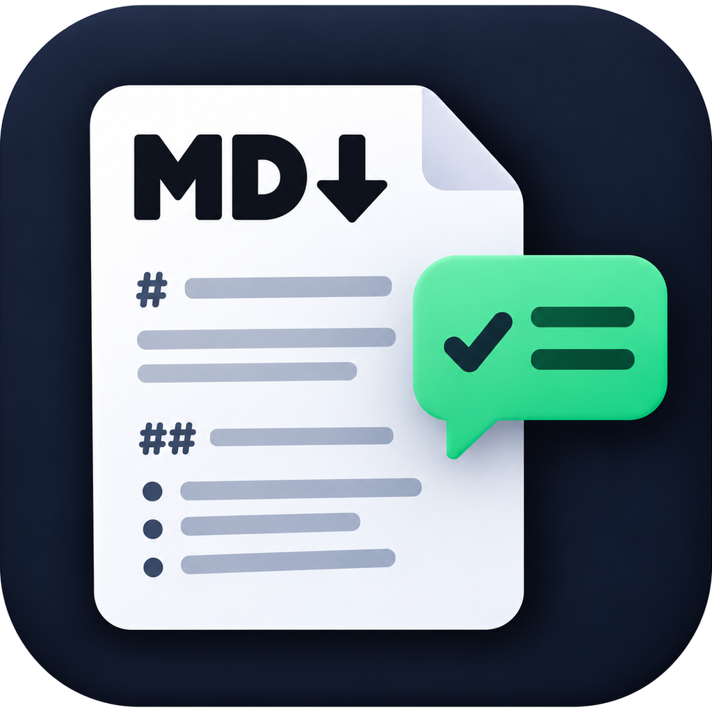
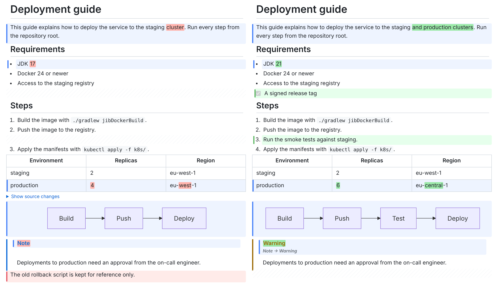
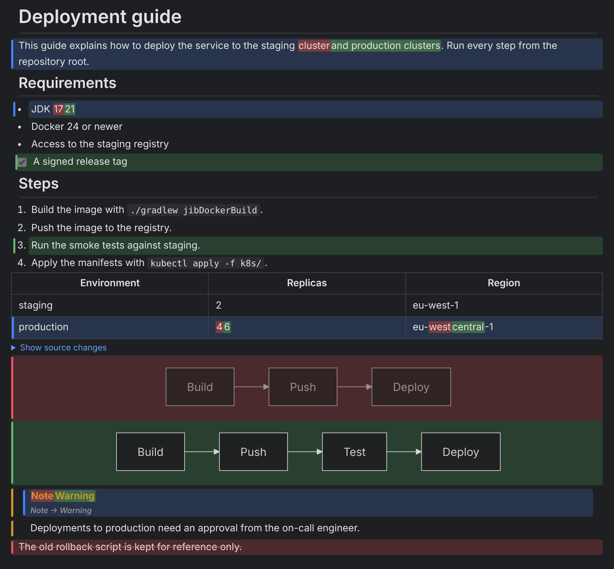

# Markdown Review

An IntelliJ IDEA plugin for reviewing changes to Markdown files in **rendered** form instead of as raw text.

## Why

A text diff of Markdown shows syntax instead of content: a rewritten paragraph becomes a few red and green lines,
a change in a table becomes shifted `|` characters, and re-indenting a list looks like everything changed.
Markdown Review shows the same comparison the way the document looks once rendered, so the reviewer judges the
content, not the markup. The plugin does not open a window of its own: it adds new viewers to IntelliJ's regular
diff window, so it works wherever the IDE shows a diff of an `.md` file.



## What the plugin does

- **Rendered side-by-side diff.** The left and right versions are rendered in two columns, with blocks (headings,
  paragraphs, list items, table rows, code blocks) aligned in rows. Removed blocks have a red background, added ones
  a green background, and the other side keeps an empty placeholder of the same height. Inside changed blocks,
  individual words are highlighted.
- **Merged view.** One column: removed parts red and struck through, added parts green. Handy for reading a large
  change quickly.
- **Mermaid diagrams.** ` ```mermaid ` blocks are drawn as diagrams, offline, in the editor's light or dark theme.
  A changed diagram shows the old and the new drawing side by side, with a "Show source changes" toggle for the line
  diff of its source. A diagram that does not parse shows Mermaid's error and its source.
- **Text diff.** IntelliJ's built-in diff is always one click away in the diff window's viewer switcher.
- **Per-block revert and apply.** Buttons on a changed block copy it to the other side, like the arrows in the text
  diff. They appear only on a side that can be edited (a local file, not a VCS revision), and each click goes through
  the IDE document as one Undo step.

The viewers work in the Commit window (Show Diff, Ctrl+D), in file history, when comparing with a branch and in pull
request windows. Compare any two files with **Compare Markdown Files...** from the project view context menu or the
Tools menu. F7 and Shift+F7 move between changes; Ctrl/Cmd+click on a block opens its source in the editor.



Settings | Tools | Markdown Review picks the viewer a Markdown diff opens with (rendered side by side, rendered
merged, or text) and holds the whitespace, collapse, pairing threshold, large-file, remote-image and Mermaid
options.

Supported Markdown: CommonMark with GitHub Flavored Markdown (tables, task lists, strikethrough, autolinks,
footnotes, alerts), HTML blocks and inline HTML (sanitized), `<details>`, HTML comments, hard line breaks, emoji
shortcodes, YAML front matter and Mermaid. The user interface is in English.

Status: 1.0. What the plugin does and does not do is described in [docs/SPECIFICATION.md](docs/SPECIFICATION.md),
what comes next in [docs/PHASE3.md](docs/PHASE3.md), and releases in [docs/RELEASING.md](docs/RELEASING.md). The
contract between the diff engine and the IDE layer is described in [docs/ENGINE_CONTRACT.md](docs/ENGINE_CONTRACT.md).
The screenshots are rendered from [docs/screenshots/sample-old.md](docs/screenshots/sample-old.md) and
[sample-new.md](docs/screenshots/sample-new.md).

## Requirements

IntelliJ IDEA (Community or Ultimate) 2025.1 or newer with JCEF support (the default in JetBrains Runtime). Without
JCEF the plugin stays out of the way: the diff window keeps the text viewer.

## Building

```
./gradlew buildPlugin
./gradlew runIde
./gradlew test
```

`./gradlew test` runs the engine tests and the IDE integration tests (`BasePlatformTestCase`, headless).

## Development

Developed with the help of Claude Code, with every change reviewed by the maintainer.

## License

The plugin bundles [Mermaid](https://github.com/mermaid-js/mermaid) 11.17.2 (MIT License); see
[THIRD_PARTY_NOTICES.md](THIRD_PARTY_NOTICES.md).

[PolyForm Noncommercial License 1.0.0](LICENSE). Noncommercial use (personal, educational, research, nonprofit
organizations) is allowed free of charge. Commercial use requires a separate license from the author.
