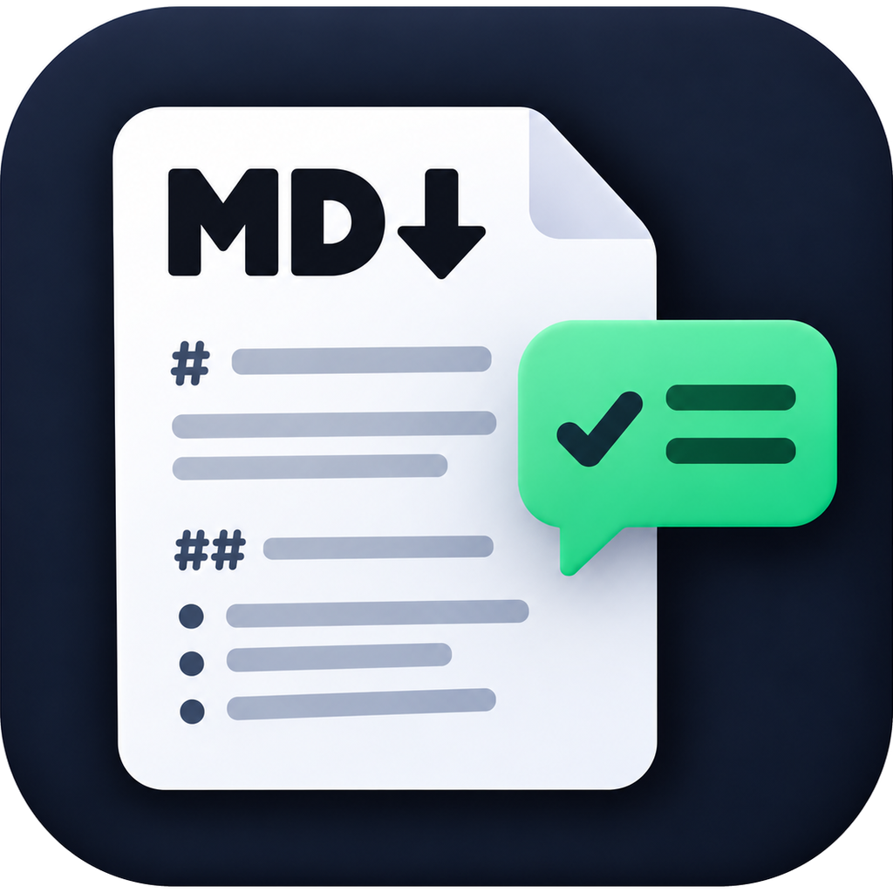
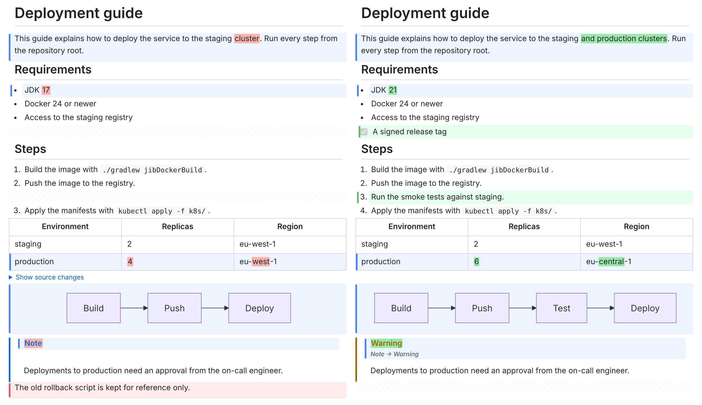
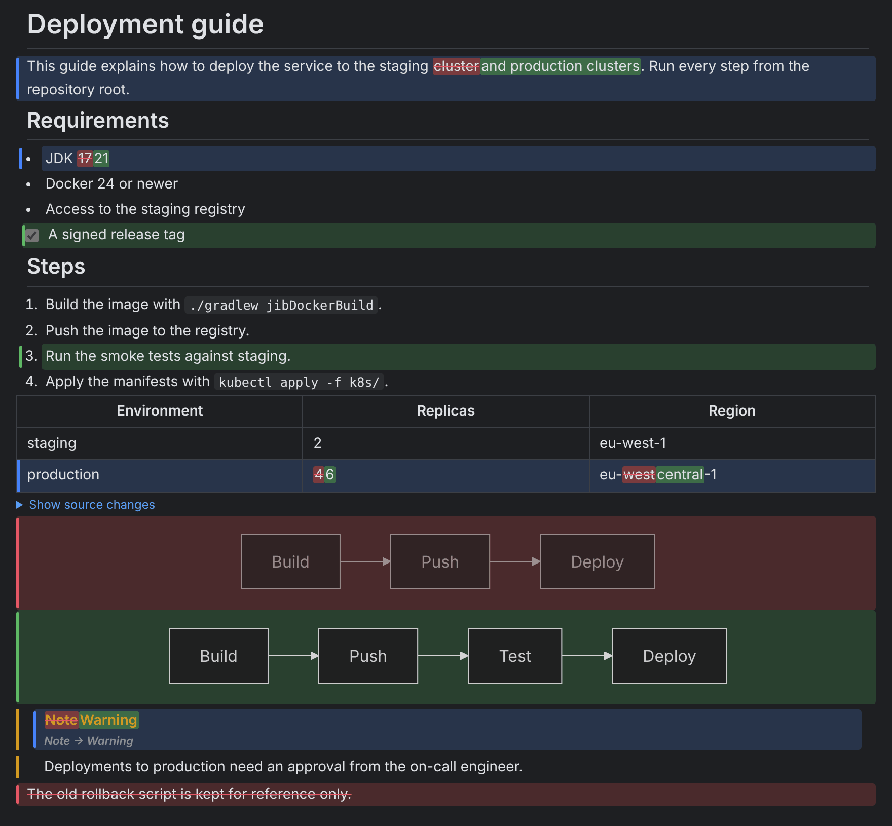
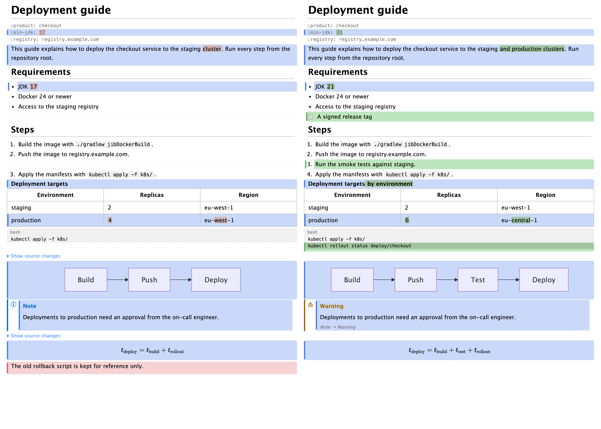
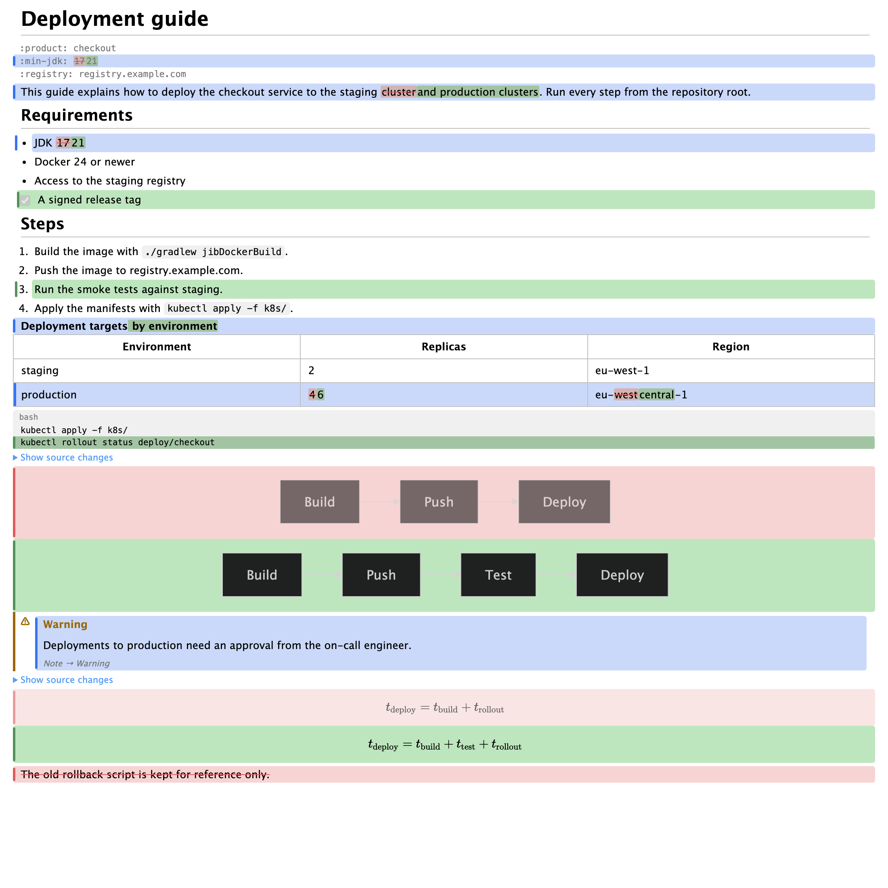

# Markdown Review

[](https://plugins.jetbrains.com/plugin/35246-markdown-review)
[](https://github.com/sponsors/agadek)
[](https://ko-fi.com/gadek)

An IntelliJ IDEA plugin for reviewing changes to Markdown and AsciiDoc files in **rendered** form instead of as raw
text.

Documentation: <https://agadek.github.io/markdown-review/>

## Why

A text diff of Markdown or AsciiDoc shows syntax instead of content: a rewritten paragraph becomes a few red and
green lines, a change in a table becomes shifted `|` characters, and re-indenting a list looks like everything
changed. Markdown Review shows the same comparison the way the document looks once rendered, so the reviewer judges
the content, not the markup. The plugin does not open a window of its own: it adds new viewers to IntelliJ's regular
diff window, so it works wherever the IDE shows a diff of an `.md` or `.adoc` file.



## What the plugin does

- **Rendered (side by side).** The left and right versions are rendered in two columns, with blocks (headings,
  paragraphs, list items, table rows, code blocks) aligned in rows. Removed blocks have a red background, added ones
  a green background, and the other side keeps an empty placeholder of the same height. Inside changed blocks,
  individual words are highlighted.
- **Rendered (merged).** One column: removed parts red and struck through, added parts green. Handy for reading a
  large change quickly.
- **Mermaid diagrams.** ` ```mermaid ` blocks are drawn as diagrams, offline, in the editor's light or dark theme.
  A changed diagram shows the old and the new drawing side by side, with a "Show source changes" toggle for the line
  diff of its source. A diagram that does not parse shows Mermaid's error and its source.
- **Math.** `$...$` and `$$...$$` formulas are drawn with KaTeX, offline. A changed formula is highlighted as a whole,
  and a changed block formula has the same "Show source changes" toggle. A formula that does not parse keeps its
  source, marked with KaTeX's error.
- **Moved blocks.** A paragraph, heading or list item that moved without changes is labeled at both ends ("Moved
  down", "Moved here from above"), with a link to the other end, instead of reading as a deletion and an addition.
  Reverting it moves it back.
- **Text diff.** IntelliJ's built-in diff is always one click away in the diff window's viewer switcher.
- **Per-block revert and apply.** Buttons on a changed block copy it to the other side, like the arrows in the text
  diff. They appear only on a side that can be edited (a local file, not a VCS revision), and each click goes through
  the IDE document as one Undo step.
- **Block source editing.** Double-click a block on a side that can be edited to change its raw Markdown or AsciiDoc
  in place; Ctrl/Cmd+Enter saves it as one Undo step, Esc cancels. The view waits with re-rendering while you type.

The viewers work in the Commit window (Show Diff, Ctrl+D), in file history, when comparing with a branch and in pull
request windows. Compare any two files with **Compare Rendered Files...** from the project view context menu or the
Tools menu. F7 and Shift+F7 move between changes; Ctrl/Cmd+click on a block opens its source in the editor.

**Show Rendered Diff** in the context menu of a Git log commit's changed files, of file history and of the Commit
window opens the selected Markdown or AsciiDoc changes in the rendered viewer, even when diffs open with the text
viewer by default.

Right-click a block for **Go to Source**, **Open in Text Diff Here** and **Show History for This Block**. Open in Text
Diff Here switches the window to the text viewer at the block's line; in a pull request window, that is where the
comment gutter starts a review comment on the block. Show History for This Block lists only the commits that changed
the block's lines, for a file under version control.



Settings | Tools | Markdown Review picks the viewer a Markdown or AsciiDoc diff opens with (**Rendered (side by
side)**, **Rendered (merged)**, or text) and holds the whitespace, collapse, pairing threshold, large-file,
remote-image, Mermaid and math options. The colors of added, removed and modified blocks and of changed words are set per color scheme in
Settings | Editor | Color Scheme | Markdown Review; a color left unset follows the scheme's Diff colors. A custom
stylesheet (a CSS file on the same settings page) can restyle the rendered view, for example to match a documentation
site, and the Export button on the viewer's toolbar saves the rendered diff as a standalone HTML file or a PDF.

Supported Markdown: CommonMark with GitHub Flavored Markdown (tables, task lists, strikethrough, autolinks,
footnotes, alerts), HTML blocks and inline HTML (sanitized), `<details>`, HTML comments, hard line breaks, emoji
shortcodes, wiki links (`[[page]]`, `[[page|label]]`), YAML front matter, Mermaid and math. The user interface is in English.

## AsciiDoc

AsciiDoc diffs use the same viewers and actions as Markdown. They need the free JetBrains AsciiDoc plugin
(`org.asciidoctor.intellij.asciidoc`) installed and enabled: Markdown Review takes AsciidoctorJ from that plugin, so
nothing AsciiDoc is bundled and Markdown diffs do not depend on it. Without the plugin an `.adoc` diff stays in the
text viewer.





Supported: sections and the document title, paragraphs, unordered, ordered, checklist, description and callout lists
with continuations, tables, listing and source blocks, admonitions, example, sidebar, quote, verse and open
containers, attribute entries and their substitution, line and block comments, conditional directives, links and
cross-references, block images, block titles, thematic and page breaks, Mermaid diagrams and `latexmath` formulas.
`include::` directives are shown as their own rows and are not resolved. Asciidoctor extensions other than Mermaid,
AsciiMath, Antora cross-component links and Asciidoctor PDF themes are not supported. Comparing a Markdown file with
an AsciiDoc file (for example after a rename) keeps the text diff.

Status: 1.3, with AsciiDoc support in the next release. What the plugin does and does not do is described in
[docs/SPECIFICATION.md](docs/SPECIFICATION.md), what comes next in [docs/PHASE3.md](docs/PHASE3.md) and
[docs/PHASE4.md](docs/PHASE4.md), and releases in [docs/RELEASING.md](docs/RELEASING.md). The contract between the
diff engine and the IDE layer is described in [docs/ENGINE_CONTRACT.md](docs/ENGINE_CONTRACT.md). The screenshots are
rendered from [docs/screenshots/sample-old.md](docs/screenshots/sample-old.md) and
[sample-new.md](docs/screenshots/sample-new.md); the AsciiDoc sample is
[sample-old.adoc](docs/screenshots/sample-old.adoc) / [sample-new.adoc](docs/screenshots/sample-new.adoc).

## Requirements

IntelliJ IDEA (Community or Ultimate) 2025.1 or newer with JCEF support (the default in JetBrains Runtime). Without
JCEF the plugin stays out of the way: the diff window keeps the text viewer.

AsciiDoc diffs also need the JetBrains AsciiDoc plugin (`org.asciidoctor.intellij.asciidoc`) installed and enabled.
Without it, AsciiDoc diffs keep the text viewer. Markdown Review does not bundle AsciidoctorJ.

## Building

```
./gradlew buildPlugin
./gradlew runIde
./gradlew test
```

`./gradlew test` runs the engine tests and the IDE integration tests (`BasePlatformTestCase`, headless).

## Development

Developed with the help of Claude Code, with every change reviewed by the maintainer. Contributions are welcome: see
[CONTRIBUTING.md](CONTRIBUTING.md), and [CHANGELOG.md](CHANGELOG.md) for what changed in each release.

## Reporting problems

[Open an issue](https://github.com/agadek/markdown-review/issues/new/choose) with the bug report template. The most
useful part is a small pair of Markdown or AsciiDoc files (old and new) that shows the problem: `old.md` / `new.md`
or `old.adoc` / `new.adoc`. Every confirmed bug gets one as a test fixture before it is fixed. For an AsciiDoc diff,
also say which AsciiDoc plugin version is installed. When the plugin throws an exception, the IDE's error dialog offers **Report to
Markdown Review on GitHub**, which opens a prefilled issue in the browser; nothing is sent until you submit it there.

## Support

Markdown Review is free for noncommercial use and maintained in spare time. It is developed with the help of Claude
Code, and sponsorships help cover the AI token budget that goes into new features and fixes. If the plugin saves you
time in reviews, you can chip in through [GitHub Sponsors](https://github.com/sponsors/agadek) or
[Ko-fi](https://ko-fi.com/gadek). Companies get a lifetime commercial license for $1 per user through GitHub Sponsors; see
[Commercial use](#commercial-use).

## License

The plugin bundles [Mermaid](https://github.com/mermaid-js/mermaid) 11.17.2 and [KaTeX](https://github.com/KaTeX/KaTeX)
0.18.11 (both MIT License); see
[THIRD_PARTY_NOTICES.md](THIRD_PARTY_NOTICES.md).

[PolyForm Noncommercial License 1.0.0](LICENSE). Noncommercial use (personal, educational, research, nonprofit
organizations) is allowed free of charge.

### Commercial use

Using the plugin for work at a company needs a commercial license, which comes with the one-time **Commercial
license** tier on [GitHub Sponsors](https://github.com/sponsors/agadek). In short:

- It costs US$1 per user, paid once: pay $25 for 25 people who use the plugin.
- It lasts for life and covers all future versions.
- The plugin has no license key or check.

The full terms are in [docs/COMMERCIAL_LICENSE.md](docs/COMMERCIAL_LICENSE.md).
