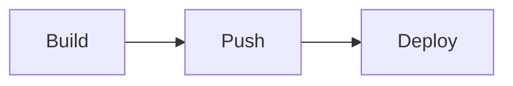

# Deployment guide

This guide explains how to deploy the service to the staging cluster. Run every step from the repository root.

## Requirements

- JDK 17
- Docker 24 or newer
- Access to the staging registry

## Steps

1. Build the image with `./gradlew jibDockerBuild`.
2. Push the image to the registry.
3. Apply the manifests with `kubectl apply -f k8s/`.

| Environment | Replicas | Region |
|---|---|---|
| staging | 2 | eu-west-1 |
| production | 4 | eu-west-1 |

> [!NOTE]
> Deployments to production need an approval from the on-call engineer.

The old rollback script is kept for reference only.
